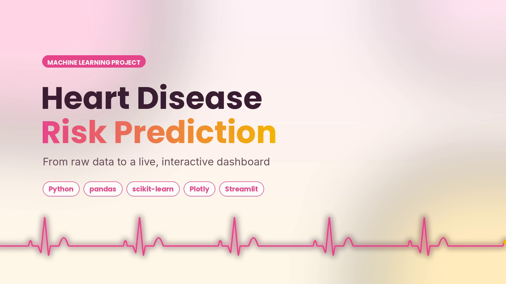
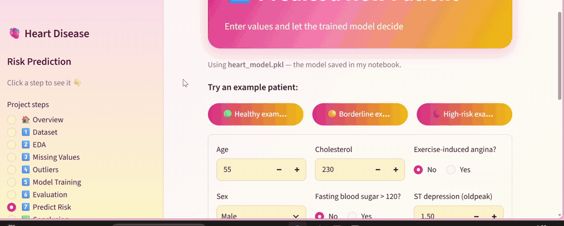
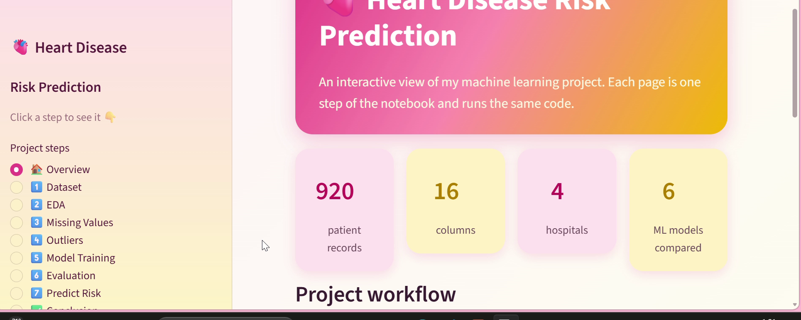
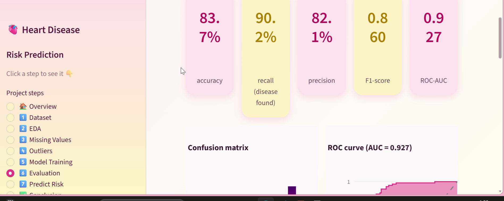
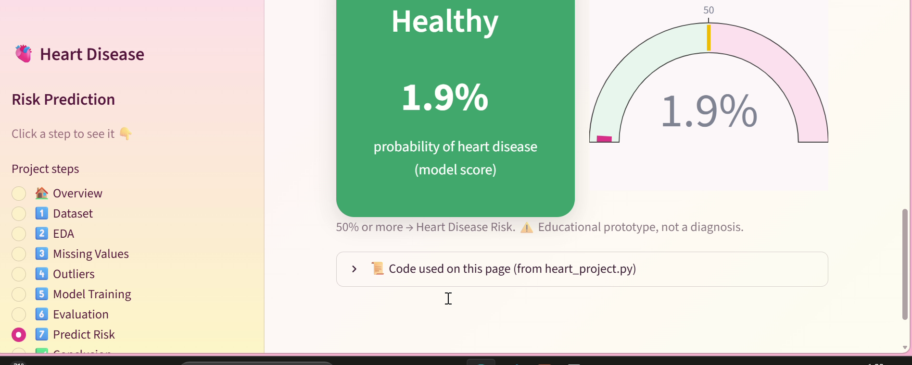
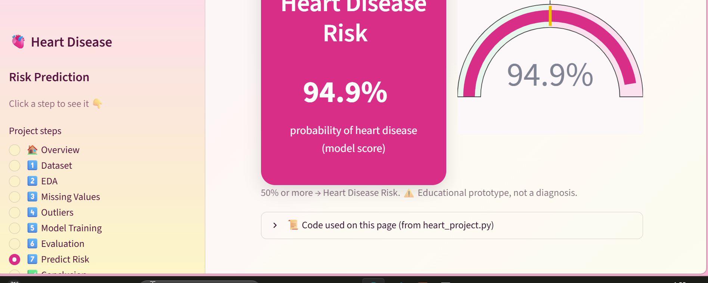
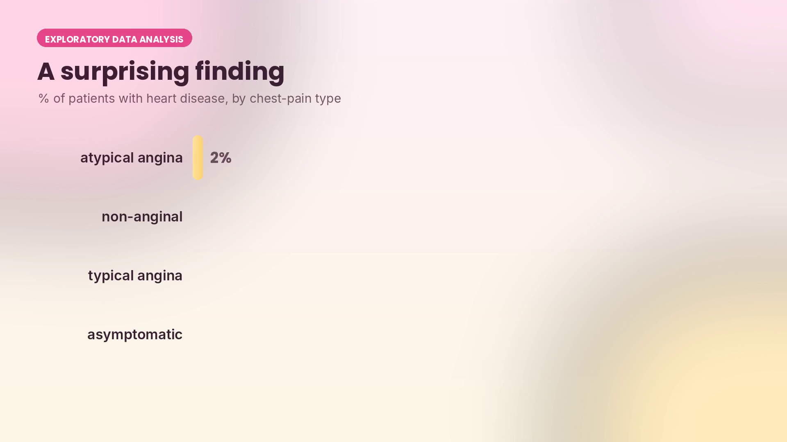
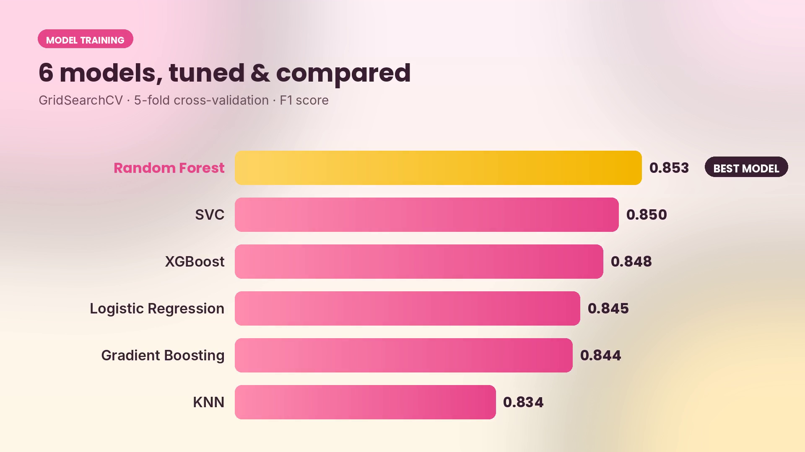

# 🫀 Heart Disease Risk Prediction

**An end-to-end machine learning project: from raw clinical data to a live, interactive Streamlit dashboard.**



Can machine learning flag high-risk patients early, using only routine medical values?
This project explores the UCI Heart Disease dataset, cleans it, trains and tunes six classifiers,
evaluates the best one on unseen patients, and serves it in an interactive dashboard.

> ⚠️ **Educational prototype.** The model gives a risk estimate learned from historical records. It is **not** a diagnostic tool and is not a substitute for a medical professional.

---

## ✨ Highlights

| | |
|---|---|
| **Data** | 920 patients · 16 columns · 4 hospitals (Cleveland, Hungary, Switzerland, VA Long Beach) |
| **Cleaning** | 1,759 missing values imputed · impossible readings (blood pressure = 0) removed |
| **Models** | Logistic Regression, SVC, KNN, Random Forest, Gradient Boosting, XGBoost |
| **Tuning** | `GridSearchCV` · 5-fold stratified cross-validation · F1 score · scikit-learn `Pipeline` |
| **Best model** | **Random Forest** (CV F1 = 0.853) |
| **Test results** (184 unseen patients) | **Accuracy 83.7%** · **Recall 90.2%** · Precision 82.1% · **ROC-AUC 0.927** |

## 🖥️ Interactive dashboard

The Streamlit app walks through every step of the notebook. Each page shows the **exact code it runs**, and the prediction page lets you test a new patient live.



| Overview | Evaluation |
|---|---|
|  |  |
| **Healthy example → 1.9% risk** | **High-risk example → 94.9% risk** |
|  |  |

## 📊 Key findings



- **79%** of patients with *asymptomatic* chest pain had heart disease, the strongest single signal in the data.
- The most important features for the Random Forest: asymptomatic chest pain, exercise-induced angina, ST depression (oldpeak), maximum heart rate and age.
- Feature importance shows what the model relies on, **not** what causes disease.



## 🗂️ Project structure

```
├── HEART_DISEASE.ipynb        # main notebook: EDA, cleaning, training, evaluation, prediction
├── heart_project.py           # the same notebook steps written as reusable functions
├── app.py                     # Streamlit dashboard (runs heart_project.py)
├── heart_disease_uci.csv      # dataset
├── heart_model.pkl            # best model saved by the notebook (joblib)
├── requirements.txt
├── .streamlit/config.toml     # dashboard theme
├── presentation/              # slide deck (PPTX + PDF)
└── images/                    # screenshots used in this README
```

## 🚀 How to run

```bash
git clone https://github.com/Mehwishnaz123/heart-disease-risk-prediction.git
cd heart-disease-risk-prediction
pip install -r requirements.txt

# open the notebook
jupyter notebook HEART_DISEASE.ipynb

# or start the dashboard
streamlit run app.py
```

The dashboard opens at `http://localhost:8501`. The **Model Training** page re-trains all six models the first time (about 1–2 minutes), then caches the result.

## 🔬 Method

1. **Exploratory data analysis**: distributions, counts and relationships with Plotly and Seaborn.
2. **Missing values**: `IterativeImputer` for numeric / true-false columns, mode for categorical columns.
3. **Outliers**: box plots; one impossible row (resting blood pressure = 0) removed; cholesterol = 0 treated as missing.
4. **Target**: `num > 0` → heart disease (508), `num = 0` → healthy (411).
5. **Preprocessing pipeline**: median imputation + `StandardScaler` for numbers, most-frequent imputation + `OneHotEncoder` for categories, all inside one `Pipeline`.
6. **Model selection**: stratified 80/20 split; `GridSearchCV` with 5-fold CV for six models; best model chosen by CV F1 and tested once.
7. **Deployment**: model saved with `joblib` and served in a Streamlit app.

## ⚠️ Limitations

- Small, older dataset (919 patients after cleaning) from four hospitals; 79% of patients are male.
- `ca` (66%) and `thal` (53%) were mostly missing and had to be imputed.
- A single train/test split; no external validation on new hospitals.
- Predicted probabilities are not calibrated clinical risk scores.

## 📚 Dataset

Janosi, A., Steinbrunn, W., Pfisterer, M., & Detrano, R. (1988). *Heart Disease* [Dataset]. UCI Machine Learning Repository. https://doi.org/10.24432/C52P4X (CC BY 4.0)

## 🛠️ Built with

Python · pandas · NumPy · Matplotlib · Seaborn · Plotly · scikit-learn · XGBoost · joblib · Streamlit

---

**Author:** Mehwish Naz, BS Computer Science, University of Larkano

⭐ If you found this project useful, consider giving it a star!
